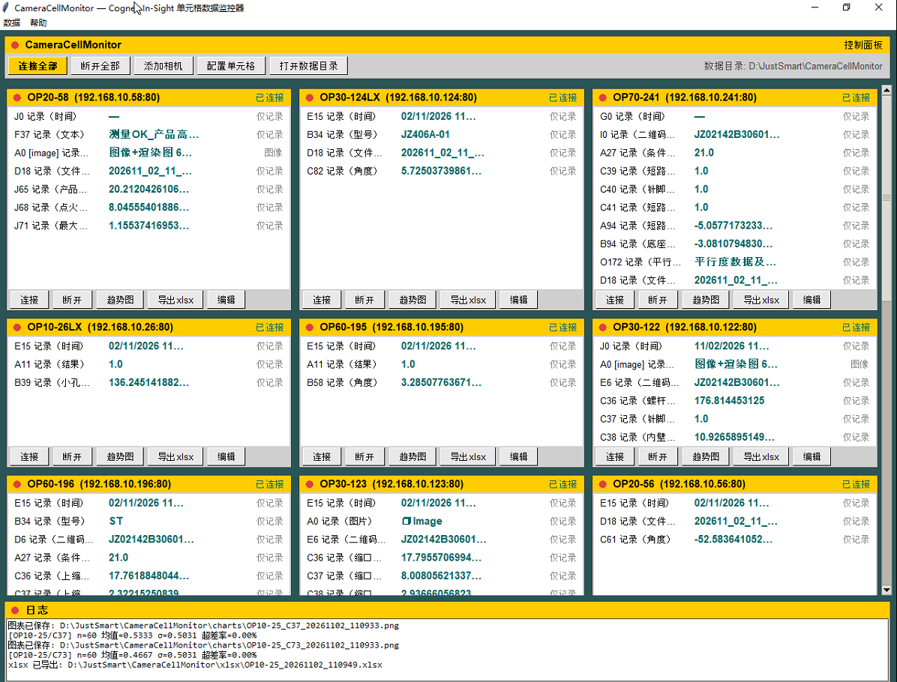
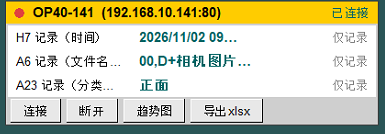
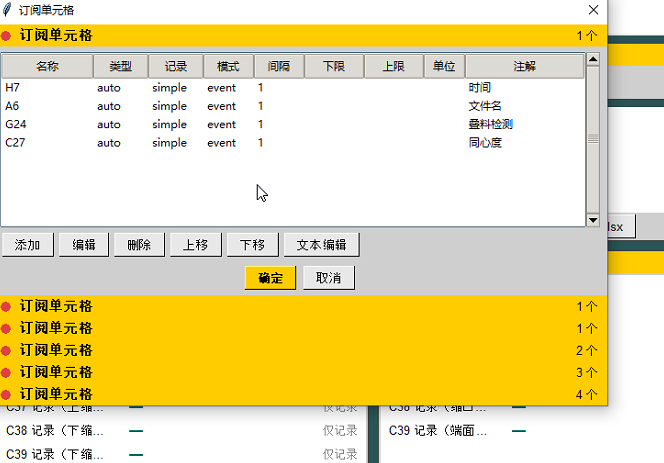

# CameraTinyMES — 迷你 MES 系统

<p align="center">
  
</p>

基于 Python 的**迷你 MES（制造执行系统）**：只依赖 `sqlite3` 等轻量库，即可在产线现场实现 MES 的核心功能——**数据采集、生产追溯、质量判定与统计报表**。

> 本工程从 [CameraCellMonitor](https://github.com/JustSmartAuto/CameraViewerTauri)（Cognex In-Sight 单元格数据监控器）派生而来，复用其相机数据采集底座，在其上扩展 MES 功能。
> 界面与交互参考 `显示软件=20260321`（CameraHelper，WinForms 多相机宫格显示软件）。

## 项目定位

| 传统 MES | CameraTinyMES |
|---|---|
| 重型架构（Oracle/SQL Server + B/S + 多服务） | 单机轻量（标准库 `sqlite3` 单文件数据库） |
| 部署复杂、需要服务器 | Python 脚本 / 单 exe 即开即用 |
| 通用行业方案 | 围绕视觉检测产线（智能相机 + GigE 工业相机）定制 |

适合**小型产线 / 试产线 / 实验线**：没有 IT 部门支持时，一台电脑 + 几台相机即可跑起来。

## 界面截图

| 界面截图 | 说明 |
|---|---|
|  | **多相机宫格主界面**：单元格实时值、连接状态与运行日志 |
|  | **单相机面板**：单元格结果与连接 / 趋势图 / 导出操作 |
|  | **单元格订阅管理**：类型、记录模式、采样间隔与上下限 |

## 功能

### 数据采集（源自 CameraCellMonitor）

- **两类相机接入**：
  - **智能相机**：Cognex In-Sight（CogSocket `ws://<相机IP>:<端口>/ws`，固件 22.2+ 默认端口 80，6.x+ 为 8087），相机在机端完成检测，软件采集其单元格结果
  - **GigE 工业相机**：支持 GigE Vision / GenICam 标准的工业面阵相机，软件取像后结合检测算法 / 判定逻辑产出结果，适合需要自主成像与检测的场景
- **多相机并发**：可同时连接 / 混用多台智能相机与 GigE 工业相机，单相机掉线自动重连，不影响其他相机
- **多单元格订阅**：智能相机每台可配置多个电子表格单元格（测量值、分数、判定结果等），支持按结果事件（`resultChanged`）触发或定时轮询（`poll_interval`）
- **单元格数据类型**：`auto / int / float / string / bool / other`，未知类型可用 `auto`（按值推断）
- **阈值判定**：advanced 记录模式 + 数值类型时按上下限判定 OK/NG；simple 模式仅记录数据、不判定

### MES 功能（本项目新增）

- **产品追溯**：以工件 / 批次号为主线，串联 检测时间、相机、单元格数据与 OK/NG 判定，可按件 / 按批查询完整检测记录
- **生产记录**：班次 / 工单 / 产品型号维度的产量统计（总数 / OK 数 / NG 数 / 直通率）
- **质量看板**：按时间、产品、 相机等多维度统计良率、超差率、CPK 等指标
- **NG 分析**：NG 明细查询与导出（xlsx + CSV），辅助根本原因分析
- **报表导出**：xlsx 报表按 相机/日期/单元格 生成工作表，所有导出文件名自动追加时间戳（`_yyyyMMdd_HHmmss`）防覆盖
- **可视化**：折线 / 散点 / 趋势图（虚线基线 = 参考值/阈值，红色段 = 超差），中文字体内嵌 `assets/`，不依赖系统字体
- **人工复核（误判标注）**：对生产数据中的误判图片进行人工复核——在图像上绘制方框 ROI 圈出误判之处，并填写误判原因 / 注意点说明；标注结果按 **XAnyLabeling 3.3.x** 格式存储（详见下文「误判标注」），可直接用于其他视觉算法训练学习误判区分

## 技术要点

| 项 | 方案 |
|---|---|
| 语言/环境 | Python 3.13，尽量只用轻量依赖 |
| 包管理 | [uv](https://github.com/astral-sh/uv)（`pyproject.toml` + `uv.lock`） |
| 智能相机通信 | CogSocket WebSocket（JSON-RPC：GET/POST/PUT/DELETE + 事件订阅），参考 `reference/CogSocket&WebApi.md` |
| GigE 工业相机 | GigE Vision / GenICam 取像（帧回调触发采样与判定） |
| 数据存储 | 标准库 `sqlite3` 单文件数据库（WAL 模式，支持多表并发写入） |
| 报表 | `openpyxl`（xlsx） |
| 图表 | `matplotlib`（中文字体从 `assets/*.ttf` 加载） |
| 界面 | tkinter（多相机宫格布局，参照 CameraHelper） |
| 打包 | PyInstaller 单文件 exe，命名 `exe_{yyyyMMddHHmmss}`，logo 使用 `assets/app_icon.ico` |

## 数据模型（SQLite）

| 表 | 说明 |
|---|---|
| `products` | 产品型号 / 配方 |
| `work_orders` | 工单（型号、计划数量、状态） |
| `records` | 采样记录：时间戳、相机、单元格、值、OK/NG、工单/批次关联 |
| `cameras` / `cells` | 相机与单元格配置 |
| 其他 | NG 明细、班次、操作日志等按需扩展 |

> 具体表结构以 `src/` 实际代码为准。

## 采样机制

**智能相机**（Cognex In-Sight）的单元格取值时机由 `sample_mode` 决定：

| 模式 | 触发方式 | 说明 |
|---|---|---|
| `event` | 相机 `resultChanged` 事件 | 订阅 `{sid}/resultChanged`，相机每次检测产出新 `HmiResult` 后回调提取单元格值并落库；处理完毕调用 `ready()` 应答，相机才继续下一帧（背压控制） |
| `poll` | 软件定时轮询 | 每隔 `poll_interval` 秒调用 `queryCellResults` 拉取单元格当前值 |

**GigE 工业相机**由软件端取像：相机帧回调 → 触发采样与判定逻辑 → 结果落库（OK/NG 判定在软件内完成，阈值配置与智能相机共用一套）。

## 误判标注（人工复核）

复核流程：从生产记录中筛选误判图片 → 人工在图像上绘制方框 ROI 标记误判位置 → 填写误判原因 / 注意点 → 保存标注文件，供其他视觉算法训练学习误判区分。

标注文件采用 **XAnyLabeling 3.3.x** JSON 格式，每张图片对应一个同名 `.json` 文件：

- **图片数据内嵌 `imageData`**（Base64 编码），**不依赖 `imagePath`**——标注文件自包含，脱离原始图片目录仍可被训练管线直接读取
- 方框 ROI 使用 `shape_type: "rectangle"`，`points` 为左上角 / 右下角两点的像素坐标
- `label` 为误判类别；`description` 记录误判原因或注意点

示例：

```json
{
  "version": "3.3.6",
  "flags": {},
  "shapes": [
    {
      "label": "misjudge_scratch",
      "score": null,
      "points": [[512.0, 340.0], [768.0, 512.0]],
      "group_id": null,
      "description": "误判原因：反光被误判为划痕；注意避免侧光角度",
      "difficult": false,
      "shape_type": "rectangle",
      "flags": {},
      "attributes": {},
      "kie_linking": []
    }
  ],
  "imagePath": "CAM01_20261108_101530.jpg",
  "imageData": "<Base64 编码的图片数据>",
  "imageHeight": 1944,
  "imageWidth": 2592
}
```

> `imagePath` 仅保留文件名作展示用途，训练读取以 `imageData` 为准。

## 目录

| 路径 | 说明 |
|---|---|
| `reference/CogSocket&WebApi.md` | CogSocket & HMI/Platform Web API 参考（连接、单元格读写、事件订阅） |
| `reference/Cognex In-Sight 3D 相机电子表格函数参考（整理版）.md` | 电子表格函数参考 |
| `reference/相机数据监控器_web_2610171547.py` | 派生来源参考实现（tkinter + 内嵌 Web） |
| `assets/annotated_ui_*.png` | 界面截图（多相机宫格 / 单相机面板 / 单元格订阅） |
| `assets/mes.jpg` | 应用 logo 原图 |

## 开发 / 运行

```bash
uv sync                              # 安装依赖
uv run mes                           # 启动应用
uv run mes --simulate                # 启动内置模拟相机离线体验完整流程
uv run python build_exe.py           # PyInstaller 打包 dist/exe_{yyyyMMddHHmmss}.exe
```

## License

[LICENSE](LICENSE) © JustSmartAuto
